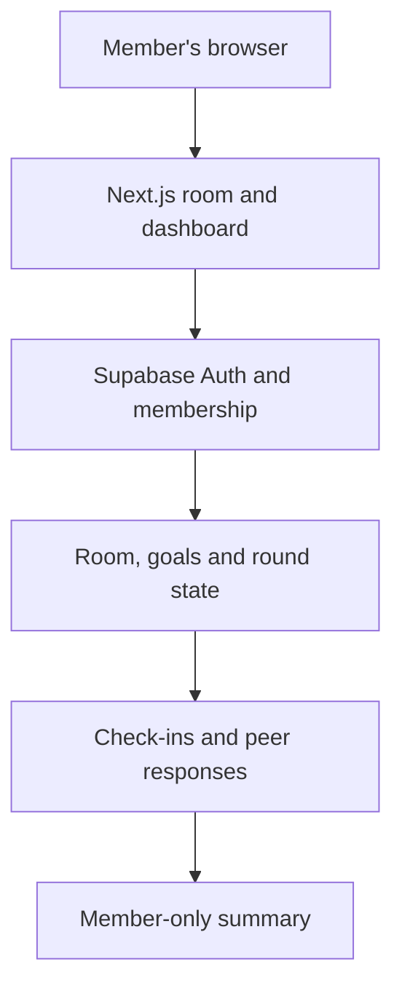

# FocusX system design

Start with the existing Next.js web scaffold and Supabase Auth and PostgreSQL. The browser displays a shared room. The server owns membership, round deadlines, results and review records.

## State and data ownership

| Record | Owner and scope | Key rule |
| --- | --- | --- |
| Profile | Signed-in student | Student can edit their own profile and see their own history. |
| Circle and invitation | Circle or room owner creates, eligible recipient accepts | Show a limited invite preview and scope the accepted access to the invitation. |
| Room and round | Room host starts, server validates participant readiness | Server records one start and deadline. Freeze ready participants at start. |
| Goal and check-in | Participant | One self-owned goal and outcome per participant/round. Record a neutral status when a participant leaves or has not posted. |
| Peer assignment and response | Server assigns, eligible reviewer acknowledges | One current assigned peer per ready participant; peer response never changes the goal or outcome. |
| Practice, mistakes and mocks | Student | Keep individual records private. A quest awards only the needed completion event. |
| Points and optional region | Owner and permitted audience | Generate points server-side and display only approved aliases and aggregates for ranking. |
| Private media | Sender and currently authorized recipients | Separate storage and access check. Honor deletion and expiry. |

Each query or mutation checks the authenticated identity and relevant membership. Keep room lists and realtime events member-only. A result or review retry uses the same logical key to avoid duplicates. Participant departure is distinct from removal of room access. A student who ends their timer can still use the ordinary check-in within the review window while their room membership remains active. Revoked access stops reads and writes.

## Timing and accountability

Use a server timestamp and deadline for the group round. Browser timers derive remaining time from that deadline and fetch current state after refresh. An in-progress room remains usable when one person leaves or disconnects. Distinguish `ready`, `studying`, `left`, `checked_in`, and passive connection information. The waiting state for a missing result is separate from a student's self-reported `missed`.

Pair two ready members with each other in R0. For a later circle, generate a cyclic assignment over the ready snapshot, using a round-dependent nonzero offset. Assign each ready member one peer and persist the result. Track own check-in and peer response separately. For missed responses, preserve the original assignment and allow a replacement under the rules in [M11](modules/M11-STUDY-BUDDY.md).

## Repository map

| Path | Purpose |
| --- | --- |
| `apps/web/` | Next.js rooms, dashboard, practice, and privacy controls |
| `supabase/` | Schema, ownership policies, membership and scoring operations |
| `docs/` | Product, feature list, roadmap and module design |
| `harness/` and `scripts/` | Pi task briefs, evidence template and plan checks |
